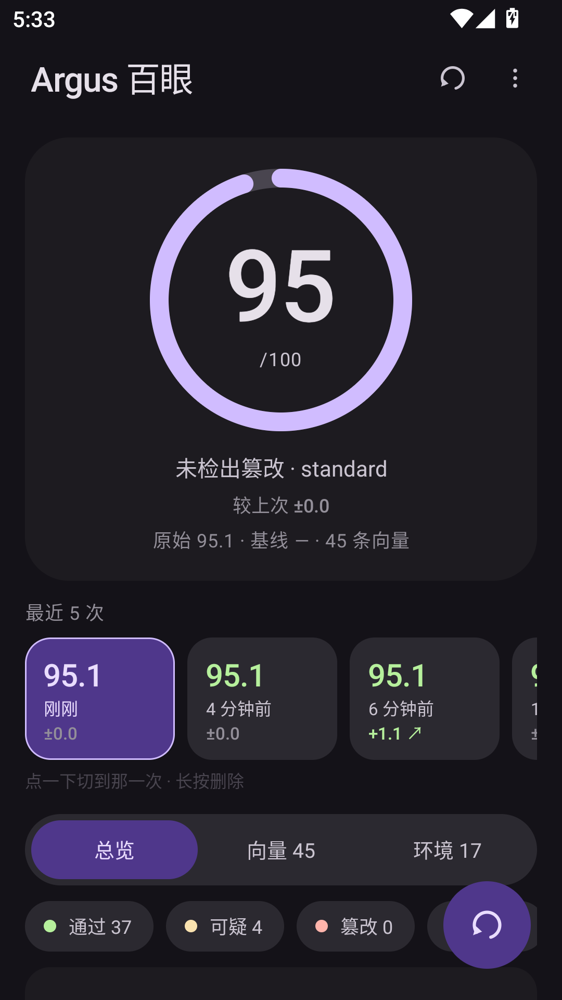
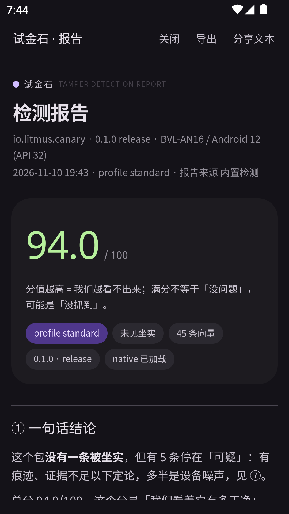

# Litmus · 试金石

<p align="center">
  <b>把「过检测」变成一个可复现的分数</b><br/>
  <i>Patch the canary, then weigh what's left.</i>
</p>

<p align="center">
  <a href="#"></a>
  <a href="#"></a>
  <a href="#"></a>
  <a href="LICENSE"></a>
</p>

> 试金石不改变金子，只告诉你成色还剩多少。我们对你的补丁做的是同一件事。

---

## 是什么

我们发布一个普通 Android 应用（靶包 `canary`），你随便修补它——重打包、换签名、注入 Frida、上 LSPosed、塞 Zygisk 模块、丢进 VirtualApp、跑在模拟器里。检测内核跑 **53 条向量**，最后给出：

| 输出 | 含义 |
| --- | --- |
| **Litmus Score**（0–100） | 越高 = 我们越看不出来 |
| **盲区 Blind Spot** | 你确实改了包，但某一整类一条都没抓到 → **我们的洞** |
| **误报 False Positive** | 包没动却被冤枉 → 这个环境里那条检测不可信 |

| 总览 | 应用内 HTML 报告 |
| --- | --- |
|  |  |

## 快速开始

```powershell
python cli/litmus.py doctor                                   # 环境自检
pwsh -File canary/build.ps1 -Install -Serial <设备序列号>       # 构建并安装靶包
python cli/litmus.py run --label C1-clean                     # 记基线
pwsh -File tools/make-repack.ps1                              # 模拟「用户重打包」
python cli/litmus.py run --label C2-repack --baseline runs/C1-clean-*/run.json
python cli/litmus.py matrix --runs runs                        # 跨版本对比
```

需要：JDK 11+、Android SDK（build-tools + 一台 arm64/x86_64 设备）。**不需要 gradle**，构建链是 `aapt2 + javac + d8 + clang++ + apksigner`。

## 为什么不是又一个 Momo

| | Momo / Ruru 类 | Litmus |
| --- | --- | --- |
| 输入 | 你的设备 | **你修补过的包** + 设备，两个平面 |
| 输出 | 一串红绿灯 | 分数 + 类别分 + **盲区 + 误报**，稳定 JSON |
| 可复现 | 靠人截图 | `run.json` 可 diff、可进 CI |
| 误报 | 无基线概念 | **基线归一**：只算你额外引入的脏 |
| 能力边界 | 闭源、不可证伪 | 盲区矩阵强制暴露「哪类根本没抓到」 |

## 通吃靠不变量，不靠特征

每条向量必须能写出一句「你做了任何注入都会破坏的等式」：

| 你做的手脚 | 一定被破坏的等式 |
| --- | --- |
| inline hook（Dobby / ShadowHook / LSPlant） | 函数入口**运行时字节 ≠ 磁盘字节** |
| PLT/GOT 劫持 | GOT 槽落点不在合法模块的 `r-x` 区间 |
| Frida 注入 | 匿名可执行段 / `TracerPid≠0` / memfd 映射 |
| 重打包、换签名 | 签名链 / APK 哈希 / ZipEntry 指纹 |
| syscall hook | 裸 `syscall` 与 libc 返回值不一致 |

**硬约束**：`tier C`（特征匹配）永远不许单独判「被坐实」，只能「可疑」，由 `tools/lint_vectors.py` 在 CI 里守着。

## 三平面

```
SELF    进程内：看得深，但可被 hook 伪造
DEVICE  设备面：看得广，但误报高（只能出「可疑」）
CLI     进程外：只有 APK 文件 + 构建期期望值 —— 包改不了这层，所以它是分数权威
```

检测器自己就跑在被修补的包里，所以凡是能在进程内被伪造的结论，都不能单独作为最终判据。

## 现状

| 已验证 | 未验证 |
| --- | --- |
| 重打包 / 换签名：5 条 A 级向量坐实，包完整性 100 → 36.1 | **注入类向量从未做过阳性对照**（没有一次真实的 Frida/LSPosed 检出记录） |
| 干净包：0 盲区 0 误报，inline 扫描 4056 个入口 0 命中 | Java 层 hook 的直接证据（`rt.art.entrypoint` 未实现） |
| CLI ≤ Java：137 项断言 + 评分公式逐字段对拍 | 内核态 hook、硬件断点、TEE 证明（见 `docs/08`） |

结论先说清楚：**现在能抓「改包」，还不能声称能抓「注入」。** 详见 [docs/08-覆盖度评估.md](docs/08-覆盖度评估.md)。

## 文档

| 文档 | 一句话 |
| --- | --- |
| [00 定位与边界](docs/00-定位与边界.md) | 卖什么、不卖什么、威胁模型 |
| [01 总体架构](docs/01-总体架构.md) | 三个平面怎么串起来，6 条技术决策 |
| [02 探针目录](docs/02-探针目录.md) | 53 条向量的判据与依赖 |
| [03 评分模型](docs/03-评分模型.md) | 分数怎么算、盲区/误报怎么定义 |
| [04 契约](docs/04-契约.md) | 冻结的接口与 JSON 格式（改这个要慎重） |
| [05 框架适配矩阵](docs/05-框架适配矩阵.md) | 11 种框架 × 10 个痕迹面 |
| [06 路线图](docs/06-路线图.md) | v0.1–v0.4 的验收标准 |
| [07 交互与报告规范](docs/07-交互与报告规范.md) | I1–I10 / R1–R8 验收指标 |
| [08 覆盖度评估](docs/08-覆盖度评估.md) | 我们到底覆盖了多少，包括没覆盖的 |

## 参考与依据

设计取舍不是拍脑袋，依据如下。

**平台机制（我们依赖的事实）**

- [APK Signature Scheme v2](https://source.android.com/docs/security/features/apksigning/v2) / [v3](https://source.android.com/docs/security/features/apksigning/v3) — 签名覆盖整包字节，`apkContentsSigners` 与 lineage 的语义
- [Android 10 隐私变更](https://developer.android.com/about/versions/10/privacy/changes) — 跨 uid 读 `/proc/<pid>/` 被收回，这是「检测内核必须内嵌」的根本原因
- [Android SELinux](https://source.android.com/docs/security/features/selinux) — `untrusted_app` 对 `/proc/self/mem`、`/proc/net` 的 neverallow
- [ART runtime](https://source.android.com/docs/core/runtime) — JIT code cache 与 `memfd:jit-*` 是干净机的常客，也是我们过滤误报的依据
- [Play Integrity API](https://developer.android.com/google/play/integrity) — 硬件级证明；我们没做，但它是「本地方案挡不住重放」的对照物

**标准与测试方法**

- [OWASP MASVS](https://mas.owasp.org/MASVS/) — RESILIENCE 类（防篡改、防逆向、反调试、防 hook）就是本项目的靶心
- [OWASP MASTG](https://mas.owasp.org/MASTG/) — 对应测试项与判定口径
- [MITRE ATT&CK Mobile](https://attack.mitre.org/matrices/mobile/) — Defense Evasion 战术，如 T1406 Obfuscated Files or Information

**我们对着什么做检测**

- [Frida](https://frida.re/docs/home/) — ptrace 注入 / gadget 内存加载两条路径
- [LSPlant](https://github.com/LSPosed/LSPlant) — ART 层 hook 入口改写
- [Dobby](https://github.com/jmpews/Dobby) / [ShadowHook](https://github.com/bytedance/android-inline-hook) — inline hook 与 PLT hook 的实现方式
- [Magisk](https://github.com/topjohnwu/Magisk) / [KernelSU](https://github.com/tiann/KernelSU) — 提权面与模块注入

**学术测量**

- Zhou & Jiang, *Dissecting Android Malware: Characterization and Evolution*, IEEE S&P 2012 — 重打包在恶意样本中的占比，是「为什么要做包完整性」的经典依据
- OWASP MASVS-RESILIENCE 的威胁模型条目 — 对抗性逆向的分级假设

## 合法使用

本项目用于验证**你自己应用 / 你自己补丁方案**的抗篡改能力。靶包是我们自己发布的、不含第三方代码的测试应用。
禁止用于绕过第三方真实保护或未授权修改他人应用。检测结果只落在本机，无任何上报。

## License

MIT · 见 [LICENSE](LICENSE)。
