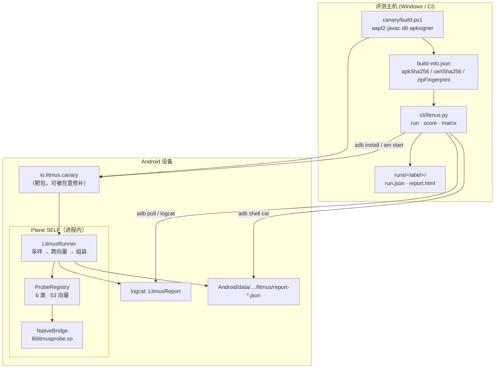

# 01 · 总体架构

> 状态：v0.1 ｜ 最后更新：2026-11-10
> 本文件解决：**东西是怎么串起来的，以及每个技术选择为什么这么定**。

---

## 1. 全景



一次运行的时序：

```
CLI                    adb                  靶包进程
 │  install -r           │                      │
 │──────────────────────▶│                      │
 │  am start -W          │   Application.onCreate
 │──────────────────────▶│─────────────────────▶│ BuildInfo.init()
 │                       │                      │ LitmusRunner.run()  ← 后台线程
 │                       │                      │   ├ AppSnapshot.capture()   (一次)
 │                       │                      │   ├ NativeBridge.snapshot() (一次)
 │                       │                      │   └ for probe in registry: run()
 │                       │                      │ LitmusRunner.publish()
 │                       │  logcat LITMUS_REPORT │   └ logcat + /sdcard/…/report.json
 │  logcat -d / cat      │◀─────────────────────│
 │◀──────────────────────│                      │
 │  合并 CLI 平面信号 → 算分 → 出报告            │
```

---

## 2. 组件职责

| 组件 | 路径 | 职责 | 不该做的事 |
| --- | --- | --- | --- |
| **Target 靶包** | `canary/src/io/litmus/canary/` | UI 记分板、触发一次检测、导出 JSON | 不实现任何判据 |
| **Runner** | `core/LitmusRunner.java` | 采样、调度、兜底、组装 report、落盘 | 不做判定、不写分数 |
| **Snapshot** | `core/AppSnapshot.java` `NativeSnapshot.java` | 一次性取证快照 | 不下结论 |
| **Probe** | `core/probes/*.java` | 一条不变量 → 一条结论 | 不写分数、不改状态、不阻塞 |
| **Score** | `core/Score.java` | App 侧即时摘要（非权威） | 不做基线归一、不做盲区 |
| **Native** | `jni/litmus_probe.cpp` | 机械取证：maps / ELF / 字节比对 / 时延 | 不做判定（改判据不该重编 so） |
| **CLI** | `cli/litmus.py` | 驱动设备、CLI 平面信号、评分（权威）、盲区、报告 | 不解析 dex、不逆向 |

**「判定」与「取证」分离**是刻意设计的：native 只输出原始事实，Java 侧解释。
这样调整阈值/增加判据不需要重新交叉编译，也不用为每个 ABI 各测一遍。

---

## 3. 关键技术决策（ADR）

### ADR-1 不用 Gradle，用 aapt2 + javac + d8 手搓

**背景**：目标机器上没有 gradle，也没有 kotlinc；`XPatch/tools/canary/build.ps1` 已验证这条路可行（20KB APK，秒级构建）。

**决定**：`canary/build.ps1` 手工构建，纯 Java，无第三方依赖。

**代价与收益**：失去 AGP 的便利（资源合并、变体、增量），换来**零依赖、可离线、构建时间 < 10s、产物可完全复现**。
对一个「安全工具」来说，构建链越短越可信。

### ADR-2 检测内核内嵌在被测包里，而不是独立检测 App

**背景**：Android 10+ 之后 `/proc/<pid>/maps` 对其它 uid 不可读（SELinux + hidepid），独立 App **看不到**目标进程的内存布局。

**决定**：检测内核以库的形式内嵌进靶包（`io.litmus.core`），跑在被测进程内。

**代价**：结论可被 hook 伪造。
**补偿**：三平面 + tier + CLI 进程外复核（见 `00-定位与边界.md` §3）。
**未来**：v0.2 把「设备面」拆成独立 detector APK，与内嵌内核形成**互证**（同一事实两个进程各看一次，不一致 → 有人改了一边）。

### ADR-3 向量按「不变量」而不是「框架特征」组织

**背景**：Momo 式工具靠特征堆砌，一换框架就要加规则，且规则可被针对性绕过。

**决定**：每条向量必须能写出一句「你做任何注入都会破坏的等式」，否则只能算 tier C 弱信号。
契约 §2.2 把这条写成硬约束：**tier C 永远不许单独判 TAMPERED**。

**代价**：实现难度高（要写 ELF 解析、字节比对、syscall 时延统计）。
**收益**：新增框架**不需要新增向量**——这也是「通吃」的唯一可持续实现方式。

### ADR-4 期望值烘在 `assets/litmus-build.properties` 而不是代码生成

**背景**：签名证书 SHA-256 在构建**前**就已知（密钥固定）；APK 自身 SHA-256 只有签完才有。

**决定**：
- 证书哈希、signer 数、证书历史 → 构建期写入 `assets/litmus-build.properties`，运行时 `BuildInfo.init()` 读；
- APK 哈希、Zip 指纹 → **不烘**，由 CLI 拿 `build-info.json` 在进程外判。

**收益**：不做代码生成 → 源码树永远可编译、IDE 直接可用；同时天然避免「期望值烘进自己 → 自己哈希变了」的死循环。

### ADR-5 报告用 JSON + 稳定 schema，而不是 protobuf/数据库

**决定**：`litmus.report/1` / `litmus.run/1`，纯 JSON，带 `schema` 字段。

**理由**：可 `cat`、可 `jq`、可 `diff`、可进 CI artifact；人可读优先。
体积不是问题（单份 < 100KB）。

### ADR-6 一个 Probe 只产出一条 Signal

**决定**：契约强制「一个 Probe 只能 emit 一次」，Runner 会丢弃第二次。

**理由**：把「聚合」从 Probe 里赶出去，交给 Score。
否则每条向量自带一套聚合逻辑，分数就再也无法被外部复算——而**可复算**是本产品的核心承诺。

---

## 4. 数据流与失败处理

```
fail at any point ──▶ 降级，不中断
├─ AppSnapshot 失败        → snapshotError 字段 + 依赖它的向量出 UNKNOWN
├─ NativeBridge 加载失败    → nat=null，所有 native 向量出 UNKNOWN（不计分母）
├─ 单个 Probe 抛异常        → 该向量 ERROR（不计分母），其余照跑
├─ 写文件失败               → 仍走 logcat
├─ logcat 单行超限          → 分片 base64（契约 §4.3）
└─ CLI 拉不到报告           → 明确报错并给出三种排查命令，不静默给 0 分
```

**原则：失败必须显形。** UNKNOWN / ERROR 都单独计数并在报告里可见，绝不当成 CLEAN——
「测不了」和「没问题」混为一谈，是这类工具最常见的原罪。

---

## 5. 扩展点

| 想加什么 | 要改哪里 | 会不会破坏契约 |
| --- | --- | --- |
| 一条新向量 | `core/probes/` 加一个类 + 注册进对应 `list()` | 否 |
| 一个新的取证维度（要 native） | `jni` 加子对象 + `NativeSnapshot` 加字段 + 一个 Probe | 否（子对象可缺省） |
| 一个新的类别 | 改 `04-契约.md` §2.1 + `Score` + `litmus_score.py` 的权重表 | **是**（升 `litmus.report/2`） |
| 一个新框架适配器 | `docs/05` 里登记 + tier C 提示集 | 否 |
| 一个新的评分 profile | 只改 CLI 的权重表 | 否 |

---

## 6. 为什么这套东西能进 CI

- 构建：`build.ps1` 一条命令，无网络、无缓存依赖；
- 运行：`litmus.py run` 一条命令，退出码 = 是否达到门禁分数；
- 断言：`run.json` 里 `score.litmus >= 阈值`、`blindSpots == []`、`falsePositives == []` 三个断言就够；
- 对比：`litmus.py matrix` 出跨版本/跨框架的对比表。

XPatch 的发布门禁可以接成：**「构建 → 修补 → 跑 Litmus → 分数不得低于上一版」**。
